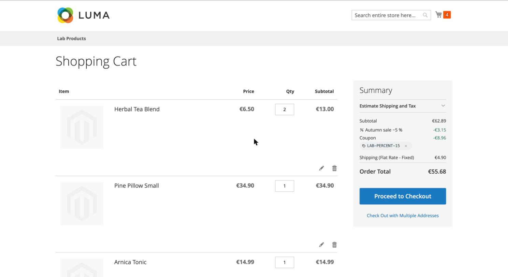
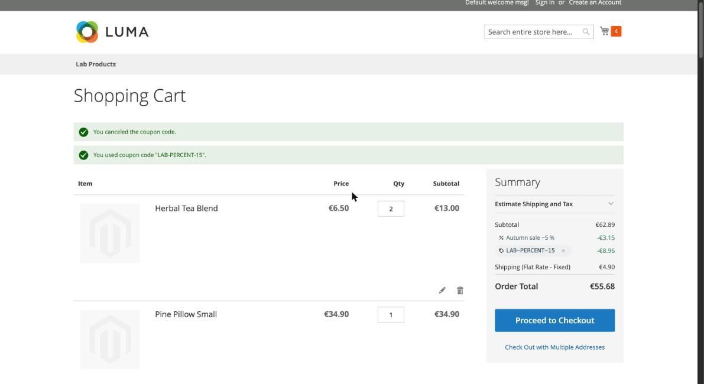
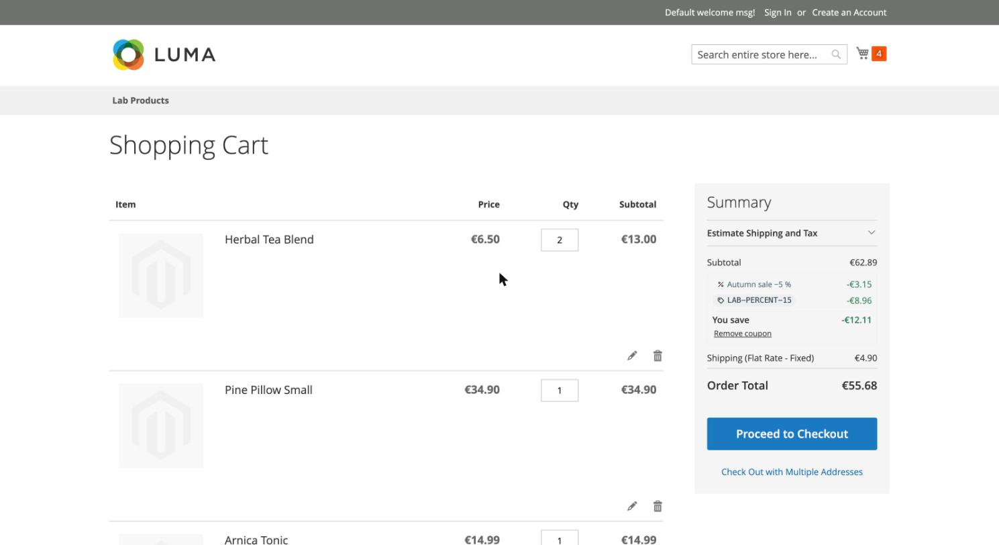
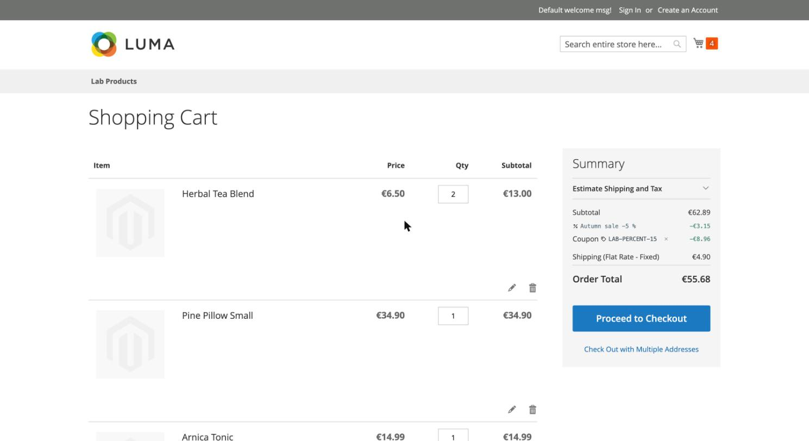
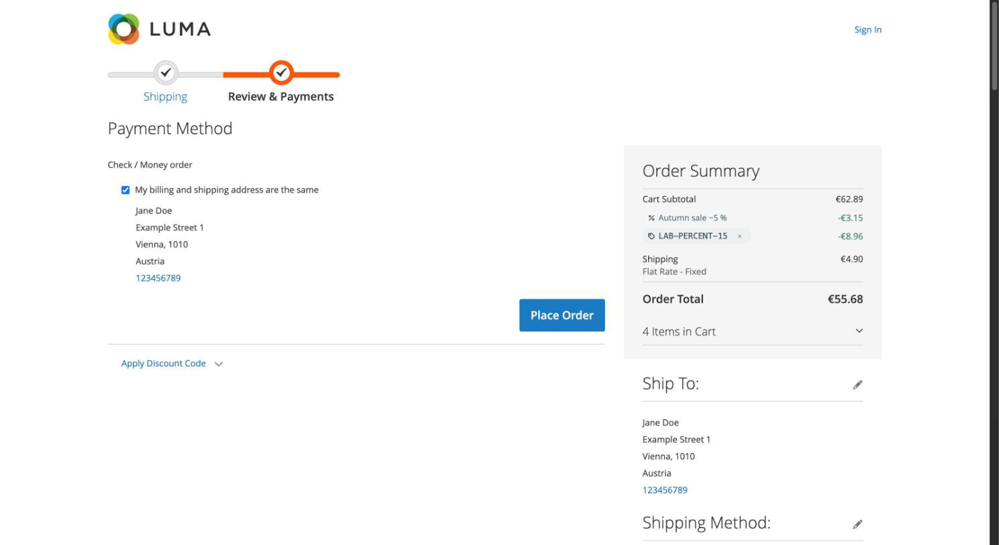

# Discount Lines for Luma

Renders one totals line per discount (coupon, automatic rule, gift, free shipping) in the Luma cart summary and the
Luma checkout sidebar, using the data and display variant (A to D) provided by
[`pixelperfectat/magento2-module-discount-lines`](https://github.com/pixelperfectat/magento2-module-discount-lines).

## Requirements

- `pixelperfectat/magento2-module-discount-lines`
- Magento 2.4 with the Luma checkout (KnockoutJS)

## Installation

```bash
composer require pixelperfectat/magento2-module-discount-lines-luma
bin/magento setup:upgrade
```

## How it works

- A RequireJS mixin on `Magento_SalesRule/js/view/summary/discount` (checkout sidebar) and
  `Magento_SalesRule/js/view/cart/totals/discount` (cart page) swaps the template for
  `PixelPerfect_DiscountLinesLuma/summary/discount-lines` and reads the lines from
  `totals().total_segments[discount].extension_attributes.discount_lines`. They update together with the totals.
  Without lines (module disabled, or a quote without stored lines) the core title and value are rendered.
- Variant, icon URLs and translated texts reach the browser through `window.checkoutConfig.ppDiscountLines`
  (`Service\CheckoutConfigProvider`).
- The "You save" sum of variant C is calculated in the browser in integer cents and only shown with more than one line.
- Labels and codes are bound with `text:` only; rule descriptions never reach the page.
- The remove button on a coupon chip is a real button with the label "Remove coupon CODE". In the checkout sidebar it
  calls the core `cancel-coupon` action (totals update in place). On the cart page it posts the cart coupon form
  (`checkout/cart/couponPost`, `remove=1`), because that page renders its coupon form on the server.
- Loads the base stylesheet `PixelPerfect_DiscountLines::css/discount-lines.css`; `view/frontend/web/css/source/_module.less`
  only resets Luma's table and button styles for the lines. Colours come from the CSS custom properties
  `--pp-dl-chip-bg`, `--pp-dl-chip-ink`, `--pp-dl-auto-bg`, `--pp-dl-auto-ink` and `--pp-dl-save`; override them on
  `:root` in your theme.

## Variants

Set under Stores > Configuration > Sales > Discount Lines: A (label with chip below), B (chip as the label, default),
C (grouped block with "You save" total), D (quiet icon and monospace).

## Configuration

Configured in the base package under Stores > Configuration > Sales > Discount Lines (store-view scope):
`pp_discount_lines/general/enabled` (default `1`) and `pp_discount_lines/display/variant` (`A` to `D`, default `B`).
See the [base README](https://github.com/pixelperfectat/magento2-module-discount-lines#configuration) for the full table.

## Contract

The data this package renders (`extension_attributes.discount_lines`, row data key `discount_line`, the label rule
and the line kinds) is described in the
[contract section of the base README](https://github.com/pixelperfectat/magento2-module-discount-lines#contract-with-the-sales-email-module).

## Known limits

- Orders placed before the base module was installed keep the merged core row.
- Existing carts show the core row until the next totals collect.
- A line list is shown whenever lines exist, even when core would hide the discount row (a quote with only a gift or
  free-shipping line).
- On the cart page the coupon remove button posts the cart coupon form, because that page renders its coupon form on
  the server.
- See the base README for the complete list of known limits.

## Screenshots

Placeholder data only, in `docs/screenshots/`:











## Development

```bash
composer install
composer check
```

## License

MIT, see `LICENSE`.
